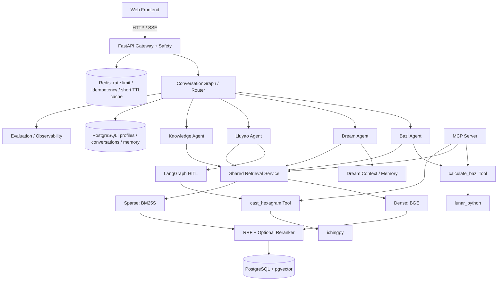

# 观尘 GuanChen v2

> 传统文化智能推演与知识服务 AI Agent Application  
> 建设基线：**GuanChen v2 冻结规划 v1.0**  
> 当前状态：**Stage 8 — Memory + Persistence 已通过验收（Stage 0–8 完成）**

## 1. Overview

观尘 GuanChen v2 是一个面向中文传统文化场景的垂直 AI Agent 应用。

项目通过：

- 确定性领域计算；
- 可追溯知识检索；
- 多轮上下文维护；
- 可恢复工作流；
- 严格的 Agent / Tool / Retrieval / Memory 边界；

为用户提供传统文化知识解释、结构化推演与现实反思服务。

项目同时服务于第二个目标：系统实践 AI Agent / LLM Application Engineering，并形成一个能够用于中国大陆 AI Agent / LLM 应用开发岗位求职展示的旗舰项目。

本项目不是“AI 算命大全”，也不以堆叠更多玄学 Agent 为目标。

---

## 2. Product Scope

GuanChen v2.0 只包含四个核心领域 Agent：

| Agent | 核心职责 | 主要工程模式 |
|---|---|---|
| Bazi Analysis Agent | 基于确定性排盘事实与知识依据解释个人八字问题 | Tool-centric |
| Dream Interpretation Agent | 在多轮对话中维护 DreamRecord，并提供传统文化 + 非诊断性情境解释 | Context-centric |
| Liuyao Decision Reflection Agent | 澄清问题、用户确认后起卦，并生成现实决策反思 | Workflow-centric / HITL |
| Traditional Culture Knowledge Agent | 基于受控知识库回答传统文化知识问题并提供来源 | Retrieval-centric |

v2.0 不增加第五业务 Agent。

---

## 3. Engineering Principles

1. **确定性计算不交给 LLM。**  
   八字排盘、六爻卦象等由代码 / 成熟库完成；LLM 负责理解、选择、解释和整合。

2. **优先复用成熟能力。**  
   能稳定调用成熟库 / 官方 API 的能力，不重复造轮子。

3. **Agent 只用于真正需要决策、语言理解和编排的地方。**  
   确定性能力优先设计为 Tool / Service。

4. **Retrieval 是共享基础设施。**  
   不为每个 Agent 单独建设一套 RAG。

5. **Memory 按领域选择，而不是全量注入。**  
   不把用户全部历史无脑塞给所有 Agent。

6. **LangGraph 在真实 Workflow 需求出现后再引入。**  
   不为了统一技术栈而提前 Graph 化。

7. **评价和可观测性是最终产品能力的一部分。**  
   项目不以“感觉能用”作为质量标准。

8. **阶段内不扩项。**  
   新想法进入 v2.1 Backlog；除非阻塞正确性、安全性或可运行性。

---

## 4. Target Architecture

> 下图描述的是 **Stage 12 完成后的目标架构**。  
> 它不代表当前已经实现这些组件。



详细说明见 [`docs/architecture.md`](docs/architecture.md)。

---

## 5. Unified Request Lifecycle

目标请求生命周期：

```text
User Request
→ Request Context Initialization
→ Safety Pre-check
→ Load Minimal Routing Context
→ Route
→ Requirement Check
→ Load Selected Domain Context
→ Execute Selected Agent(s)
→ Tool / Retrieval As Needed
→ Response + Citation
→ Explicit / Confirmed Memory Update
→ Complete
```

以下能力属于横切关注点，而不是单一业务节点：

- Trace / Observability
- Persistence / Checkpoint
- Error Handling
- Streaming / SSE

详细说明见 [`docs/request_lifecycle.md`](docs/request_lifecycle.md)。

---

## 6. Roadmap

| Stage | Theme |
|---:|---|
| 0 | Product / Domain / Architecture Freeze |
| 1 | Engineering Skeleton + LLM Foundation |
| 2 | Bazi Deterministic Tool |
| 3 | Bazi Agent Vertical Slice |
| 4 | Shared RAG + Knowledge Agent |
| 5 | Dream Agent + Context Engineering |
| 6 | Liuyao Agent + LangGraph HITL |
| 7 | Router + Multi-Agent Orchestration |
| 8 | Memory + Persistence |
| 9 | MCP Standardization |
| 10 | Evaluation + Observability |
| 11 | Safety + FastAPI + SSE + Frontend Integration |
| 12 | Production Deployment + Interview Delivery |

详细路线见 [`docs/roadmap.md`](docs/roadmap.md)。

---

## 7. Current Implementation Status

### 已完成：Stage 0 – Stage 8

| Stage | 主题 | 状态 |
|---:|---|---|
| 0 | Product / Domain / Architecture Freeze | 完成 |
| 1 | Engineering Skeleton + LLM Foundation | 完成 |
| 2 | Bazi Deterministic Tool | 完成 |
| 3 | Bazi Agent Vertical Slice | 完成 |
| 4 | Shared RAG + Knowledge Agent | 完成 |
| 5 | Dream Agent + Context Engineering | 完成 |
| 6 | Liuyao Agent + LangGraph HITL | 完成 |
| 7 | Router + Multi-Agent Orchestration | 完成 |
| 8 | Memory + Persistence | 完成（本阶段） |

### Stage 8 交付摘要

- **Postgres 域表**：`user_profile` / `birth_profile` / `conversation` / `message` / `dream_record` / `decision_record` + `conversation_states`（SQLAlchemy async、FK 级联、索引、`created_at` / `updated_at`）。
- **SQLAlchemy async repository 层**：UserProfile / BirthProfile（upsert = 用户更正覆盖语义）/ Conversation（幂等 append）/ DreamRecord / DecisionRecord。
- **LangGraph PostgreSQL 持久 checkpointer**：官方 `AsyncPostgresSaver` + `AsyncConnectionPool` 封装（`memory/checkpointer.py`），六爻 HITL 线程跨进程可恢复。
- **Memory Selector 领域隔离**：BAZI 只注入 `BIRTH_PROFILE`；LIUYAO 在待确认状态注入决策问题种子；DREAM / KNOWLEDGE / CHITCHAT 不注入任何历史记忆——不把全历史无脑塞给模型。
- **长期记忆写回**：八字执行成功后持久化出生资料（重启免重问）；六爻每次决策持久化 `DecisionRecord`（含 thread_id，支持 `resume` 接力）。
- **三类必测全绿**：持久化 / 恢复 / 隔离（见 `tests/` 与 `docs/stage_status.md`）。

### 验证状态

```text
默认套件：358 passed, 43 deselected
集成套件（-m integration，含 Stage 8 Memory）：42 passed
静态检查：ruff check src tests scripts 通过
Stage 7 路由 Eval（full-chain）：黄金集 65 条，primary / secondary accuracy 均 100%
Stage 4 Retrieval Eval：45 条，RRF Recall@5=0.9111；reranker 未通过 Gate，生产保持关闭
Stage 4 Knowledge Agent：10/10 真实回答 citation lineage 通过
Stage 8 应用验收：32 个真实入口场景通过
```

### 尚未实现（目标架构，后续 Stage）

- MCP Server（Stage 9）
- Evaluation + Observability runtime（Stage 10）
- FastAPI / SSE / 前端集成（Stage 11）
- Redis、生产部署（Stage 12）

---

## 8. Documentation

- [`docs/product_charter.md`](docs/product_charter.md)
- [`docs/agent_contracts.md`](docs/agent_contracts.md)
- [`docs/user_flows.md`](docs/user_flows.md)
- [`docs/domain_models.md`](docs/domain_models.md)
- [`docs/request_lifecycle.md`](docs/request_lifecycle.md)
- [`docs/architecture.md`](docs/architecture.md)
- [`docs/roadmap.md`](docs/roadmap.md)
- [`docs/backlog_v2_1.md`](docs/backlog_v2_1.md)
- [`docs/learning_knowledge_map.md`](docs/learning_knowledge_map.md)
- [`docs/adr/`](docs/adr/)

---

## 9. Stage Discipline

每一个 Stage：

1. 开始前确认目标、固定任务、新知识、调用 / 自研边界、测试范围、非目标和完成标准；
2. Stage 内只完成当前 Stage 的冻结任务；
3. Gate 未通过，不进入下一 Stage；
4. 新想法进入 v2.1 Backlog；
5. 只有正确性、安全性或不可运行的阻塞问题可以触发最小方案变更，并记录 ADR。

当前 Stage 9（MCP Standardization）尚未开始；Stage 8 Gate 已通过，可进入 Stage 9。
