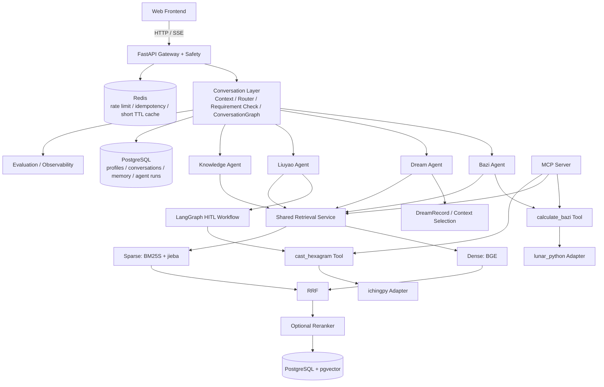

# GuanChen v2 Architecture

- Status: **Target Architecture Frozen**
- Version: **v1.0**
- Current Implementation: **Stage 0 only**
- Important: 本文件描述 Target Architecture，不代表所有组件已经实现。

---

# 1. Purpose

本文描述 GuanChen v2 的：

- 目标系统架构；
- 组件职责；
- 核心数据流；
- 领域 Agent 边界；
- 共享基础设施；
- 渐进式架构演进原则。

具体能力是否已经实现，以根目录 README 的 Current Implementation Status 为准。

---

# 2. Architecture Principles

1. Deterministic computation belongs to code / tools.
2. LLMs handle understanding, selection, explanation and synthesis.
3. Reuse mature libraries instead of rebuilding domain algorithms.
4. Introduce infrastructure only when a real requirement appears.
5. Keep Agent boundaries domain-specific.
6. Retrieval is shared infrastructure.
7. Memory is selected by domain, not globally injected.
8. Evaluation and observability are first-class production concerns.
9. New scope does not enter v2.0 outside the frozen roadmap.
10. Complexity must be earned by requirements.

---

# 3. High-Level Target Architecture



---

# 4. Layer Responsibilities

## 4.1 Gateway Layer

目标 Stage：11+

职责：

- HTTP entry；
- Safety boundary；
- SSE streaming；
- API contract；
- session identity。

业务层不依赖 HTTP 对象。

## 4.2 Conversation Layer

目标 Stage：7+

职责：

- minimal routing context；
- Router；
- Requirement Check；
- domain context selection；
- top-level orchestration；
- explicit double-domain fan-out / fan-in。

## 4.3 Domain Agent Layer

### Bazi

Tool-centric：

```text
BirthProfile
→ calculate_bazi
→ BaziChart
→ Retrieval
→ Interpretation
```

### Dream

Context-centric：

```text
Dream Description
→ DreamRecord
→ Context Selection / Merge
→ Retrieval
→ Multi-perspective Interpretation
```

### Liuyao

Workflow-centric：

```text
Question
→ Clarification
→ HITL Confirm
→ cast_hexagram
→ HexagramResult
→ Retrieval
→ Reflection
```

### Knowledge

Retrieval-centric：

```text
Knowledge Query
→ Retrieval
→ Evidence
→ Grounded Answer
→ Citation
```

---

# 5. Shared Retrieval Service

目标 Stage：4+

```text
KnowledgeDocument / KnowledgeChunk
→ ingestion
→ embedding
→ PostgreSQL / pgvector

Query
├── Dense Retrieval
├── Sparse Retrieval
↓
RRF
↓
Optional Rerank
↓
Metadata Filter / RetrievalResult
↓
KnowledgeCitation
```

原则：

- 项目只有一套共享 Retrieval Service；
- 不为每个 Agent 建独立 RAG；
- metadata domain filter 防止跨领域污染；
- Citation 必须可追溯到实际 chunk。

---

# 6. Memory and Persistence

目标 Stage：8+

需要严格区分：

## Thread / Workflow State

例如 Liuyao workflow interrupt state。

由 LangGraph checkpointer 管理。

## Long-term Business Memory

例如：

- BirthProfile；
- DreamRecord；
- DecisionRecord；
- explicit UserProfile fields。

由 PostgreSQL 业务 schema 管理。

原则：

> Memory Selector 按领域加载，禁止全量历史注入。

---

# 7. External Interfaces

## Web

目标 Stage：11。

- FastAPI
- SSE
- HITL UI
- Citation
- Tool / Retrieval status

## MCP

目标 Stage：9。

只暴露成熟能力：

- `calculate_bazi`
- `knowledge_search`
- `cast_hexagram`

MCP 是外部互操作层，不是内部调用总线。

---

# 8. Evaluation and Observability

目标 Stage：10。

评价资产：

- Bazi fixtures
- Retrieval golden set
- Router dataset
- HITL workflow cases
- e2e cases

Observability：

- AgentRun
- RunStep
- token
- latency
- error
- retrieved chunk ids
- status

项目自身评价报告不依赖外部 SaaS。

---

# 9. Production Infrastructure

目标 Stage：12。

```text
Docker Compose
├── API
├── PostgreSQL + pgvector
└── Redis
```

外部：

- Nginx
- HTTPS
- GitHub Actions

明确不做：

- Kubernetes
- microservices
- Kafka
- Celery
- service mesh
- multi-region HA

---

# 10. Architecture Evolution

```text
Stage 1
LLM Foundation
    ↓
Stage 2
Deterministic Bazi Tool
    ↓
Stage 3
First Agent Vertical Slice
    ↓
Stage 4
Shared Retrieval
    ↓
Stage 5
Context-centric Dream Agent
    ↓
Stage 6
LangGraph HITL
    ↓
Stage 7
Multi-Agent Orchestration
    ↓
Stage 8
Persistent Memory
    ↓
Stage 9
MCP
    ↓
Stage 10
Evaluation / Observability
    ↓
Stage 11
Web Runtime
    ↓
Stage 12
Production
```

核心原则：

> 先出现真实问题，再引入解决该问题的架构能力。

---

# 11. Why Rebuild from Scratch

v2 不直接沿用旧版源码作为代码基线。

旧版只作为：

- 需求原型；
- 反例库；
- 架构演进素材。

v2 重点修正：

- Router / 依赖流程不完整；
- 所有请求过早依赖 BirthProfile；
- RAG ingestion / retrieval contract 不一致；
- 宣称支持但真实算法链路不完整的能力；
- 可靠性结构早于业务闭环出现。

---

# 12. ADR Index

- ADR-001: Use lunar_python for Bazi deterministic calculation
- ADR-002: Use PostgreSQL + pgvector for vector storage
- ADR-003: Use ichingpy for Liuyao deterministic calculation
- ADR-004: Introduce LangGraph only when workflow requirements justify it
- ADR-005: Use MCP as an external interoperability layer

详见 `docs/adr/`。
