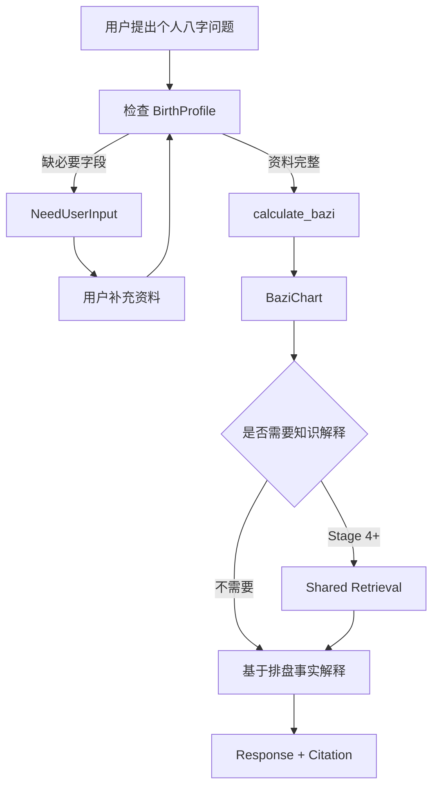
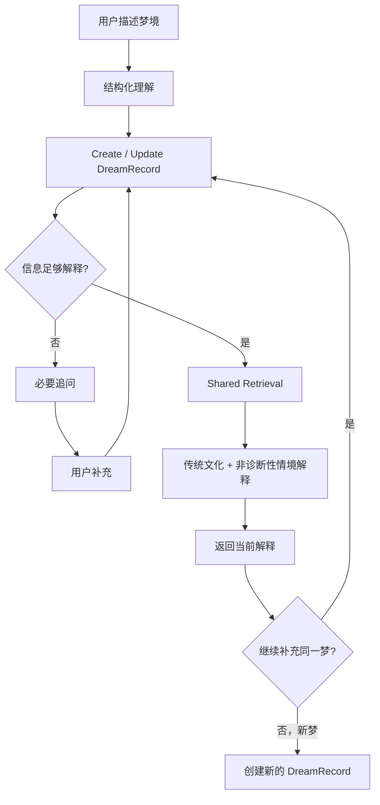
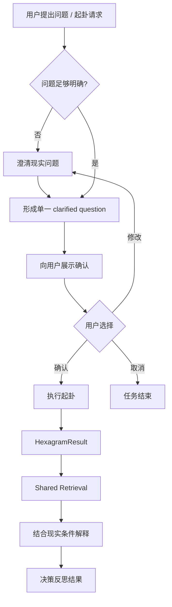
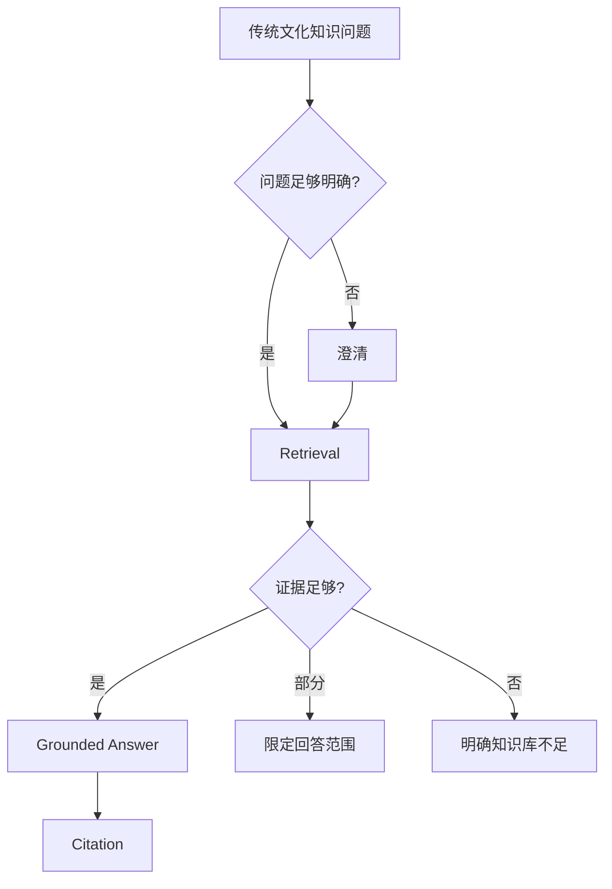

# GuanChen v2 Four Agent User Flows

- Status: **Frozen**
- Version: **v1.0**

本文件描述用户可感知的业务流程，不描述具体 Python / LangGraph / API 实现。

---

# 1. Bazi Analysis Flow

## 1.1 Main Flow



## 1.2 Missing Data

正式个人排盘需要：

- 出生日期；
- 出生时间；
- 性别。

出生地文本可保存，但 v2.0 不参与排盘。

资料不全：

```text
→ NeedUserInput
→ calculate_bazi calls = 0
```

用户补充后继续原任务，不开启陌生新任务。

## 1.3 Failure Branches

### Invalid Birth Data

```text
Invalid Input
→ 明确指出字段问题
→ 请求用户更正
→ 不执行正式排盘
```

### Tool Failure

```text
calculate_bazi failed
→ 明确计算失败
→ 不允许 LLM 自行补造四柱
```

### Retrieval Failure

```text
BaziChart valid
+ Retrieval evidence insufficient
→ 排盘事实仍有效
→ 限定知识解释范围
```

---

# 2. Dream Interpretation Flow

## 2.1 Main Flow



## 2.2 Clarification Rule

没有固定必填字段。

仅当缺失信息会显著影响解释时追问：

> Minimum Necessary Clarification

## 2.3 Correction

```text
Round 1: “梦里是我同事。”
Round 2: “记错了，是高中同学。”
```

当前有效 DreamRecord 应更新为“高中同学”，而不是保留冲突事实期待 LLM 自行猜测。

## 2.4 New Dream

用户开始描述另一个梦：

```text
→ New Dream
→ 创建新的 DreamRecord
```

不能把多个梦错误合并。

## 2.5 Retrieval Failure

没有可靠传统材料时：

- 不伪造象征意义；
- 可以给有限的非诊断性情境反思；
- 必须区分证据性质。

---

# 3. Liuyao Decision Reflection Flow

## 3.1 Main Flow



## 3.2 Clarification

例如：

```text
“帮我看看以后怎么样。”
```

过于宽泛，应先澄清为可确认的单一问题。

## 3.3 Confirmation Invariant

```text
confirmed == false
→ cast_hexagram forbidden
```

用户修改问题：

```text
clarified_question = new question
confirmed = false
→ 重新确认
```

## 3.4 Cancel

```text
用户取消
→ 不执行 cast tool
→ workflow terminate
```

## 3.5 Tool Failure

```text
cast_hexagram failed
→ 明确失败
→ 不允许 LLM 自行创造 HexagramResult
```

## 3.6 Retrieval Failure

```text
HexagramResult valid
+ Evidence insufficient
→ 卦象事实有效
→ 限定知识解释范围
```

---

# 4. Knowledge Agent Flow

## 4.1 Main Flow



## 4.2 Clear Knowledge Query

例如：

```text
“什么是十神？”
```

直接 Retrieval，不要求 BirthProfile。

## 4.3 Ambiguous Query

只有存在真实领域歧义时才追问，且应尽量少。

## 4.4 Insufficient Evidence

```text
Retrieval = no reliable evidence
→ 明确知识库不足
```

禁止依赖模型记忆伪造原典出处。

---

# 5. Cross-Agent Flow Examples

| Query | Flow |
|---|---|
| 什么是日主？ | Knowledge |
| 我的日主是什么？ | Bazi |
| 梦见蛇有什么传统含义？ | Knowledge（一般知识） |
| 昨天我梦见蛇咬我。 | Dream |
| 什么叫变卦？ | Knowledge |
| 帮我起一卦看看要不要换工作。 | Liuyao |

Stage 7 才实现真实 Router；本文件只冻结业务归属。
